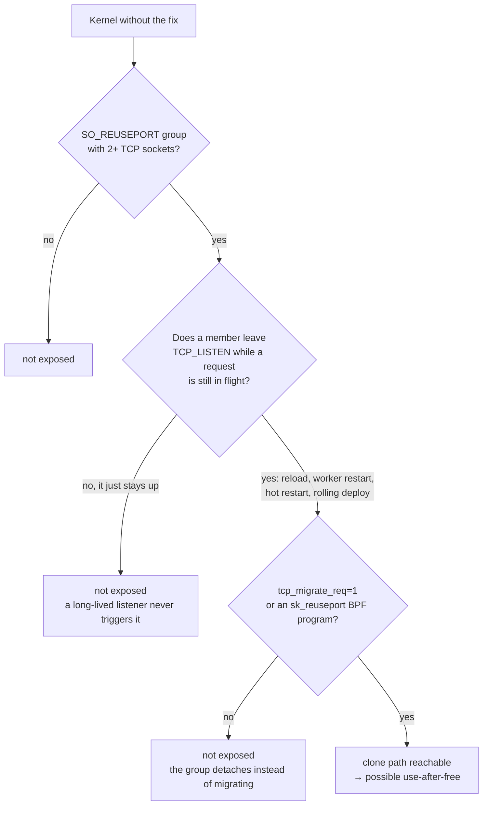
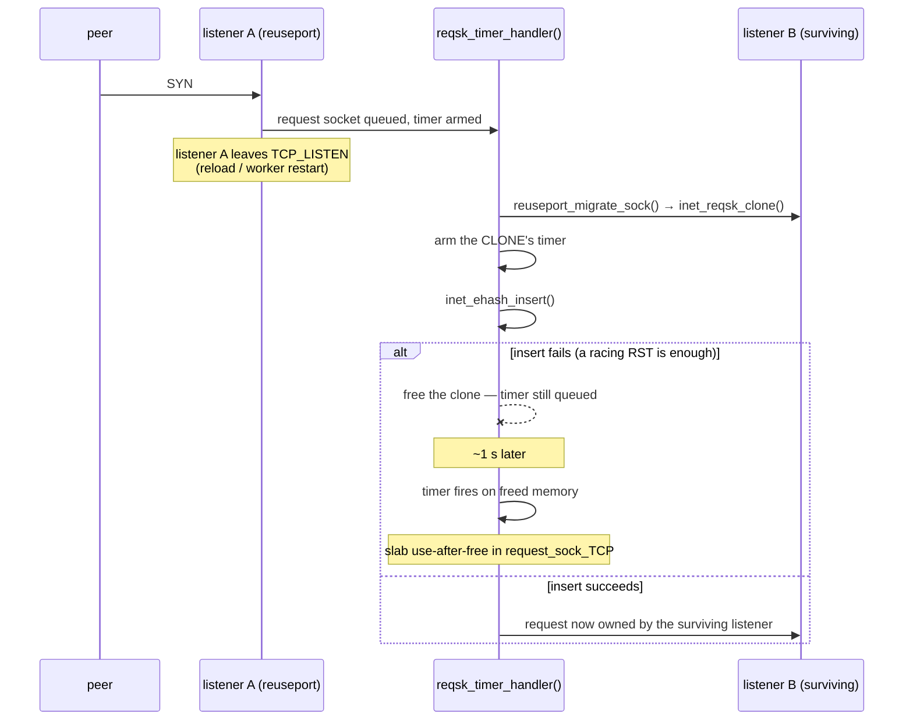

<p align="center">
  
</p>

<h1 align="center">reqsk-uaf-check</h1>

<p align="center">
  Does your Linux kernel have the fix? One command, read-only, no install.<br>
  <a href="https://github.com/ezolabs/reqsk-uaf-check/blob/main/LICENSE">MIT</a> ·
  <a href="https://ezolabs.io/security">EZO Labs security</a>
</p>

---

## Which vulnerability this checks

| | |
|---|---|
| **Bug** | Use-after-free in a TCP request socket (`request_sock_TCP`), in `reqsk_timer_handler()` |
| **CVE** | **none assigned.** We requested an id from the kernel CNA on 2026-11-01. Until one exists this is identified by its fix: [Linux kernel commit `97c8a3c1f73d`](https://github.com/torvalds/linux/commit/97c8a3c1f73d828de43a5a88e8a9a143efb2b661) |
| **Fixed in** | [Linux kernel](https://github.com/torvalds/linux) **v7.1** — `linux-7.1.y:1123` passes `false`. Still unfixed everywhere else we read it: `linux-7.0`, the `linux-6.12.y` branch at `:1161`, the `linux-6.18.y` branch at `:1138`, and Ubuntu **6.8.0-149** at `inet_connection_sock.c:1100`. Each still passes `true` |
| **Related, different CVE** | [**CVE-2026-98432**](https://www.cve.org/CVERecord?id=CVE-2026-98432) — *ipv4: free inet_opt and ireq_opt after an RCU grace period*, fixed by [Linux kernel commit `e3f33b0a1d89`](https://github.com/torvalds/linux/commit/e3f33b0a1d89). Same function, **different bug**. Patching that one does not fix this one. |

## What a vulnerable box allows an attacker to do

The kernel frees a request socket while its timer is still queued. About a second later that timer
fires **on freed memory**.

- **Kernel panic.** Any host with a `SO_REUSEPORT` group that reloads is a remote denial of service
  from a single crafted connection. We reproduced this.
- **Slab corruption.** The freed object can be reallocated before the timer fires. We reproduced the
  reclamation and the resulting use-after-free under KASAN.

The attacker needs no credentials and no position on the host. What they do need is for the target
to have a reuseport group that changes membership — which a reload, a worker restart or a rolling
deploy does routinely.

## Run it

```sh
sudo ./kernel-check.sh
```

Verdicts: **`VULNERABLE`** the fix is absent · **`PATCHED`** it is present · **`UNDETERMINED`** the
image could not be read, and the check says so rather than guessing.

Root is needed for a complete answer: `/proc/kcore` is mode `0400`, real `/proc/kallsyms` addresses
need root or `CAP_SYSLOG` unless `kptr_restrict=0`, and `bpftool prog show` needs `CAP_BPF`. Run it
unprivileged and those steps return `UNDETERMINED` — it tells you which step it could not do.

It reads `/boot`, `/proc` and `bpftool prog show`. It writes only to its own `mktemp` directory and
removes it on exit.

```
--proc-root DIR    alternative /proc (testing aid; default /proc)
--boot-root DIR    alternative /boot (default /boot)
--json             machine-readable output
--help
```

## Is my host actually exposed?

The verdict is necessary, not sufficient. All four must hold, and three are host-local:



That third box is the one most deployments fail. A reuseport group that never changes membership is
safe even on a vulnerable kernel. The checker reports the reuseport group, the BPF program and the
`tcp_migrate_req` value so you can answer it.

## How the defect works

A request socket is created for each incoming SYN. When a listener in a `SO_REUSEPORT` group stops
listening, the kernel can migrate the pending request to a surviving member — by **cloning** it.



The fix is one line in the Linux kernel, [`net/ipv4/inet_connection_sock.c`](https://github.com/torvalds/linux/blob/v7.0/net/ipv4/inet_connection_sock.c) ([commit `97c8a3c1f73d`](https://github.com/torvalds/linux/commit/97c8a3c1f73d828de43a5a88e8a9a143efb2b661)):

```diff
-  __inet_csk_reqsk_queue_drop(sk_listener, nreq, true);
+  __inet_csk_reqsk_queue_drop(sk_listener, nreq, false);
```

The third argument tells the drop path whether the **caller** owns the timer. The error path does
not — it never armed one on the original socket — so `true` leaves the clone's timer queued across
the free. `false` makes the drop path delete it.

## How the verdict is decided

From **the compiled instruction at the deciding call site**, never from the version string. On a
vulnerable image the branch reads `movl $0x1,%edx` (`from_timer=1`); on a patched image,
`xorl %edx,%edx`.

That matters because distributors backport fixes without changing the version, and because a version
number is a claim about upstream while a backport is what is actually installed.

## Tests

```sh
bash test/run-tests.sh
```

48 assertions pass against the fixtures in `test/fixtures/`.

Six cases additionally need real kernel binaries that are **not** shipped in this repository
(`vmlinux.elf` and `vmlinuz-7.0.0-28-generic`, resolved from the project directory above the
checkout). In a clean clone they print `SKIP  <name>  (missing <path>)` and do not run:
`vulnerable-image`, `vulnerable-disabled`, `vulnerable-bpf`, `vulnerable-no-group`, `ss-partial`,
`ss-no-header`. They pass wherever those two files are present.

## Limits

- **x86-64 only.** It decodes the x86 instruction at the call site. On arm64 it reports
  `UNDETERMINED` rather than a wrong answer.
- It answers for the running kernel, or for an image you point at with `--boot-root`.
- `VULNERABLE` means the kernel carries the defect. It does not mean the host is exploitable — see
  the exposure diagram.

## Credit

The defect and the fix are upstream work by **Kuniyuki Iwashima**, reported by **Damiano Melotti**.
This repository is only a checker; it claims no discovery.

## Licence

MIT. See [LICENSE](LICENSE).
