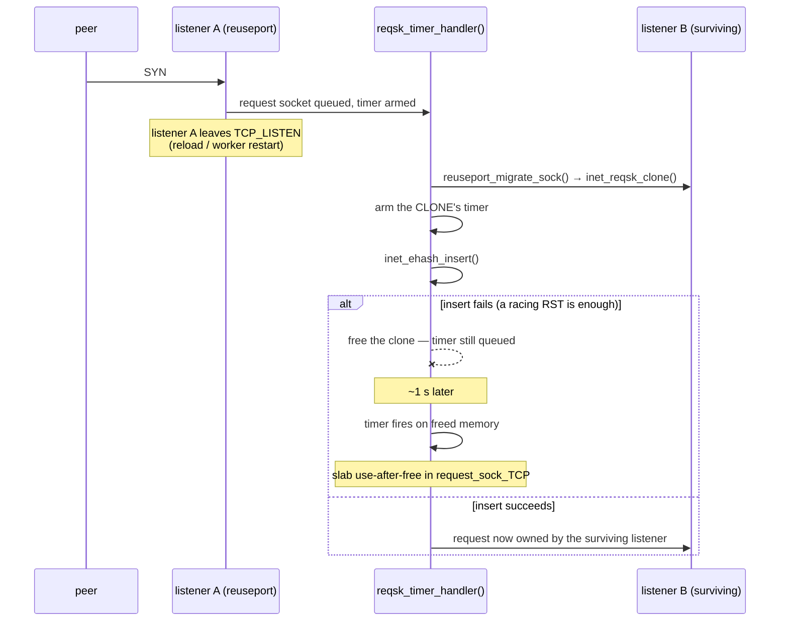
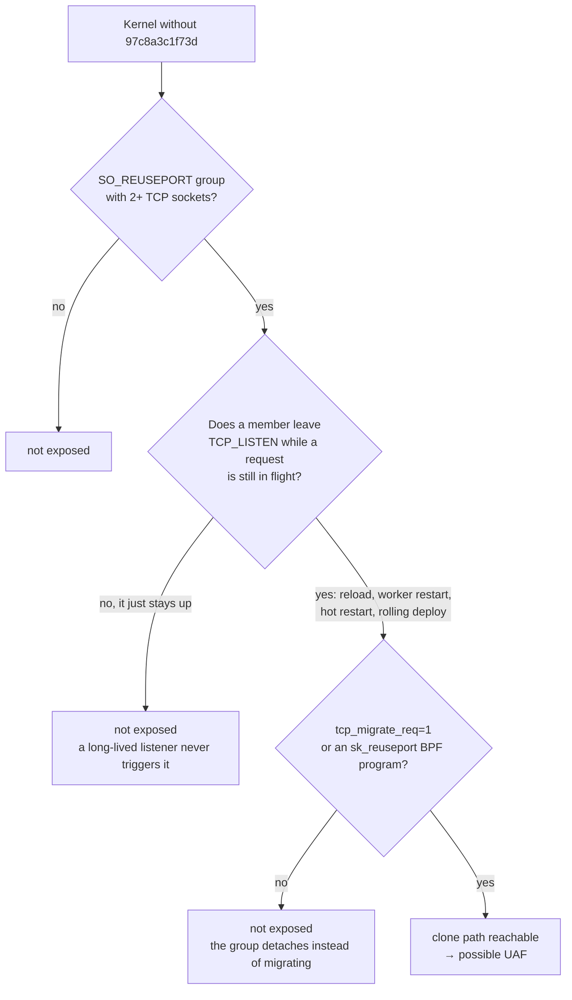

<p align="center">
  
</p>

<h1 align="center">reqsk-uaf-check</h1>

<p align="center">
  A read-only checker for a Linux kernel request-socket use-after-free.<br>
  <a href="https://github.com/ezolabs/reqsk-uaf-check/blob/main/LICENSE">MIT</a> ·
  <a href="https://ezolabs.io/security">EZO Labs security</a>
</p>

---

It tells you whether **your** kernel carries the fix for a slab use-after-free in
`request_sock_TCP`. It does not scan anything remote, install anything, or write outside a
private temporary directory.

## Advisories

| | |
|---|---|
| Fix this checker decides | **`97c8a3c1f73d828de43a5a88e8a9a143efb2b661`** — "tcp: Fix potential UAF in `reqsk_timer_handler()`" |
| CVE for that fix | **none assigned.** We requested an id from the kernel CNA on 2026-11-01; until one exists, this repository describes it by commit |
| Related but **different** CVE | [**CVE-2026-98432**](https://www.cve.org/CVERecord?id=CVE-2026-98432) — *ipv4: free inet_opt and ireq_opt after an RCU grace period*, fixed by `e3f33b0a1d89` |

**CVE-2026-98432 is not the bug this tool checks.** It lives in the same function and the same
subsystem, and the two are routinely confused. That defect is a post-free *leak* of `ireq_opt`; this
one is a *use-after-free* of the request socket itself, and it is fixed by a different commit. If a
tool or an advisory tells you `e3f33b0a1d89` fixed your kernel, it has said nothing about
`97c8a3c1f73d`.

## How the defect works

A request socket is created for each incoming SYN. When a listener belongs to a `SO_REUSEPORT`
group and one member of that group stops listening, the kernel can *migrate* the pending request to
a surviving member — and it does that by **cloning** the request socket.



The fix is one line in `net/ipv4/inet_connection_sock.c`:

```diff
-  __inet_csk_reqsk_queue_drop(sk_listener, nreq, true);
+  __inet_csk_reqsk_queue_drop(sk_listener, nreq, false);
```

The third argument tells the drop path whether the **caller** owns the timer. The error path does
not — it never armed one on the original socket — so passing `true` leaves the clone's timer queued
across the free. Passing `false` makes the drop path delete it.

## When a host is actually exposed

All four must hold, and three are host-local:



That third box is the one most deployments fail. A `SO_REUSEPORT` group that never changes
membership is safe even on a vulnerable kernel, because the clone is only created during migration.

## What the check answers

| verdict | meaning |
|---|---|
| `VULNERABLE` | the deciding call site passes `true` |
| `PATCHED` | it passes `false` |
| `UNDETERMINED` | the image needed to decide was not readable, and the check says so rather than guessing |

The verdict comes from **the compiled instruction at the deciding call site**, never from the
version string. That matters because distributors backport fixes without changing the version, and
because a version number is a claim about upstream while a backport is what is actually installed.

Concretely, on a vulnerable image the branch reads `movl $0x1,%edx` (`from_timer=1`); on a patched
image, `xorl %edx,%edx`. The checker also reports whether a TCP `SO_REUSEPORT` group exists, whether
an `sk_reuseport` BPF program is attached to it, and the value of `net.ipv4.tcp_migrate_req`.

## Running it

```sh
sudo ./kernel-check.sh
```

Root is needed for a complete answer: `/proc/kcore` is mode `0400`, real `/proc/kallsyms` addresses
need root or `CAP_SYSLOG` unless `kptr_restrict=0`, and `bpftool prog show` needs `CAP_BPF` to list
all programs. Run it as an unprivileged user and those steps return `UNDETERMINED` rather than a
guess — the check tells you which step it could not do.

It reads `/boot`, `/proc`, and `bpftool prog show`. It writes only to its own `mktemp` directory and
removes it on exit.

```
--proc-root DIR    alternative /proc (testing aid; default /proc)
--boot-root DIR    alternative /boot (default /boot)
--json             machine-readable output
--help
```

## Tests

```sh
bash test/run-tests.sh
```

48 assertions pass against fixture kernels: a patched image, a vulnerable image, an image whose BPF
program map does not match, and one whose kcore is unreadable.

## Coverage and limits

- **x86-64 only.** It decodes the x86 instruction at the call site. On arm64 it reports
  `UNDETERMINED` rather than a wrong answer.
- It answers for the kernel currently running, or for an image you point it at with `--boot-root`.
- A `VULNERABLE` verdict means the kernel carries the defect. It does **not** mean a given host is
  exploitable — that also needs a `SO_REUSEPORT` group that actually changes membership while a
  request socket is alive, which the check reports but cannot force.

## Credit

The defect and the fix are upstream work by **Kuniyuki Iwashima**, reported by **Damiano Melotti**.
This repository is only a checker; it claims no discovery.

## Licence

MIT. See [LICENSE](LICENSE).
